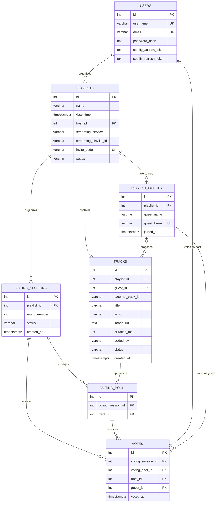

# Entity-Relationship Diagram — Sonoma

## 1. Mermaid Diagram

## 2. Key Business Constraints

### 2.1. Playlist Ownership and Guest Membership

- Each playlist must have exactly one host, referenced by `playlists.host_id`.
- A playlist can have multiple guests, identified by `playlist_guests`.
- Guests can join a playlist without creating an account.
- Each guest has a unique `guest_token`.
- Each playlist has a unique `invite_code`.

### 2.2. Track Ownership and Origin

Tracks can be added either by the host or by a guest.

The `tracks` table enforces the following rules through the `tracks_origin_check` constraint:

- If `added_by = 'host'`, then `guest_id` must be `NULL`.
- If `added_by = 'guest'`, then `guest_id` must not be `NULL`.

The composite foreign key:

`(guest_id, playlist_id) REFERENCES playlist_guests(id, playlist_id)`

ensures that a guest proposing a track belongs to the same playlist as that track.

The constraint `tracks_unique_external_id` prevents the same Spotify track from being added more than once to a given playlist.

Track durations must also be greater than zero.

### 2.3. Voting Sessions and Voting Pool

Each voting session belongs to a playlist and has a unique round number within that playlist.

The following constraint prevents duplicate round numbers:

`UNIQUE (playlist_id, round_number)`

The `voting_pool` table associates tracks with voting sessions.

Its constraints ensure that:

- The same track cannot appear more than once in a given voting session.
- Each voting pool entry can be uniquely identified within its voting session.

The constraint:

`UNIQUE (voting_session_id, track_id)`

prevents duplicate entries for the same track in a voting round.

### 2.4. Vote Integrity

Each vote belongs to a voting session and references a track included in that session's voting pool.

The composite foreign key:

`(voting_pool_id, voting_session_id) REFERENCES voting_pool(id, voting_session_id)`

ensures that a vote references a voting pool entry belonging to the specified session.

The `votes_voter_check` constraint ensures that each vote is associated with exactly one type of voter:

- A host, through `host_id`.
- A guest, through `guest_id`.

Both fields cannot be populated simultaneously, and neither can be left `NULL`.

The following unique constraints prevent the same participant from voting more than once in a given session:

- `UNIQUE (voting_session_id, host_id)`
- `UNIQUE (voting_session_id, guest_id)`

These constraints apply separately to hosts and guests.

### 2.5. Data Integrity and Cascading Deletes

The database also enforces several additional constraints:

- Usernames and email addresses must be unique.
- Usernames, email addresses, playlist names, and streaming service names cannot be empty or contain only whitespace.
- Playlist statuses must be `preparing`, `active`, or `finished`.
- Track statuses must be `proposed`, `voting`, `selected`, or `played`.
- Voting session statuses must be `active` or `closed`.
- Voting round numbers must be positive.

Several foreign keys use `ON DELETE CASCADE`.

For example, deleting a playlist automatically deletes its associated guests, tracks, and voting sessions. Dependent voting pool entries and votes can also be deleted through cascading foreign keys.

## 3. Business Rules Enforced by the Backend

Some business rules cannot be fully guaranteed by the database constraints currently defined in the migration. These must be implemented and validated by the backend.

### 3.1. Maximum Number of Tracks per Voting Round

The backend must enforce a maximum of **15 tracks per voting session**.

This limit is documented in the migration but is not enforced by a database constraint.

### 3.2. Playlist Lifecycle and Permissions

The playlist status indicates its current lifecycle stage:

- `preparing`: The host can add tracks directly to the playlist.
- `active`: The host and guests can propose tracks for voting.
- `finished`: The party has ended.

The backend must enforce the appropriate permissions and allowed operations for each status.

For example, it must prevent guests from proposing tracks when a playlist is still being prepared or has already finished.

It must also ensure that tracks added during an active party follow the voting process.

### 3.3. Host Authorization

The database ensures that a playlist references an existing host through `playlists.host_id`.

However, it does not automatically guarantee that a host voting on a playlist is the owner of that playlist.

The backend must verify that the authenticated host is authorized to perform the requested action on the relevant playlist.

### 3.4. Guest Authorization

The composite foreign key on `tracks` ensures that a guest proposing a track belongs to the same playlist as the track.

However, the database does not enforce the equivalent membership relationship for votes.

The backend must verify that a guest voting in a session belongs to the playlist associated with that session.

It must also validate guest tokens before allowing guests to propose tracks or vote.

### 3.5. Voting Session Rules

The database ensures that a voting session belongs to a playlist and that a vote references an entry in the correct voting session.

However, the backend must enforce the voting workflow, including:

- Only allowing votes while a voting session is active.
- Preventing votes after a session has been closed.
- Ensuring that only eligible participants can vote.
- Applying the rules used to determine which tracks are selected.
- Updating track statuses consistently with the voting process.

### 3.6. Track Status Transitions

The database restricts track statuses to the following values:

- `proposed`
- `voting`
- `selected`
- `played`

However, it does not enforce valid transitions between these statuses.

The backend must ensure that tracks follow the intended workflow, for example:

`proposed → voting → selected → played`

The exact transitions should reflect the application's business rules.

### 3.7. External Streaming Service Integration

The database stores Spotify track information, including the external track ID, title, artist, image URL, and duration.

The backend must handle interactions with the Spotify API and validate the relevant track information.

It must also ensure that external playlist operations remain consistent with the application's internal data.

---

## 4. Summary

The database is responsible for:

- Maintaining entity relationships and referential integrity.
- Enforcing uniqueness and basic data validation.
- Ensuring that votes reference the correct voting sessions and voting pool entries.
- Preventing duplicate votes by the same participant within a voting session.
- Enforcing track origin rules and guest membership for track proposals.

The backend is responsible for:

- Enforcing permissions and authorization.
- Managing playlist and voting session lifecycles.
- Enforcing the maximum number of tracks per voting round.
- Validating guest access tokens.
- Enforcing valid track status transitions.
- Applying voting rules and determining the selected tracks.
- Managing the integration with Spotify.
